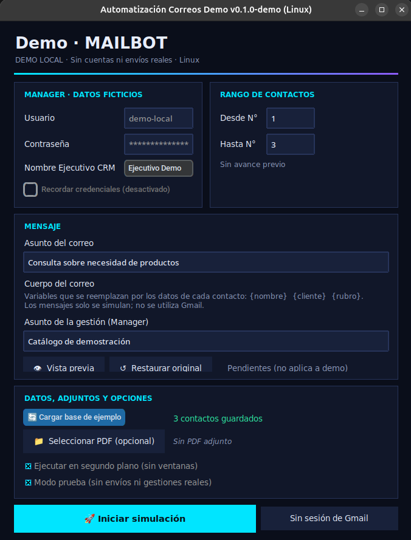
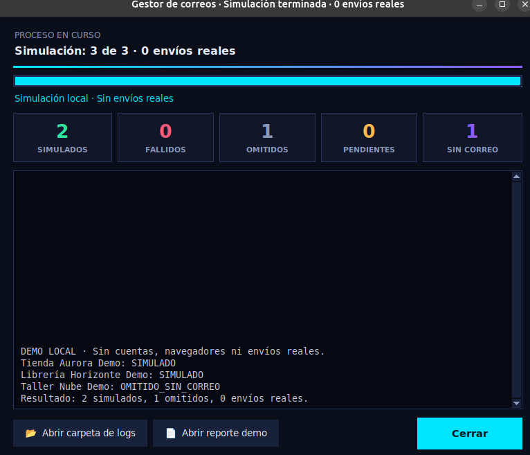

# Gestor de correos · Demo local

Aplicación de escritorio en Python para demostrar la preparación de campañas: contactos, mensajes personalizados, adjuntos PDF y reportes. **Esta versión simula el proceso; no envía correos ni inicia sesión en servicios reales.**
La demo conserva ahora el diseño del formulario y la ventana de progreso originales. Los campos de cuenta son ficticios y están deshabilitados. Las integraciones reales siguen bloqueadas: no basta con cambiar enlaces para activarlas.

## Vista previa

### Formulario



### Resultado de la simulación



## Origen y objetivo

Este proyecto personal nació por iniciativa propia para automatizar tareas repetitivas de seguimiento de contactos. La versión de portafolio usa una identidad genérica y datos ficticios. No incluye contactos, credenciales, logotipos, registros ni ejecutables de la instalación original.

El programa original reunía su código en un archivo de 3427 líneas. Se separaron sus 120 funciones y clases principales en módulos por responsabilidad. La lógica de integración original se conserva para revisión, con sus puntos de entrada reales bloqueados. La demo conserva el diseño original mediante adaptadores locales: mantiene las tarjetas, los colores, el formulario y la ventana de progreso, con identidad genérica y sin conexiones reales.

## Qué puedes probar

- Elegir un rango de contactos ficticios en el formulario original.
- Personalizar un asunto y un mensaje mediante `{nombre}`, `{cliente}` y `{rubro}`.
- Revisar el mensaje antes de simular la campaña.
- Comprobar un PDF sin modificarlo ni enviarlo.
- Simular el lote y distinguir contactos procesados de contactos sin correo.
- Consultar el reporte JSON generado en `datos/reportes_demo/` al terminar una simulación. El modo de terminal también permite exportarlo a una ruta elegida.

## Instalación

Necesitas Python, Tkinter, CustomTkinter y Pillow. CustomTkinter y Pillow se instalan con `requirements.txt`. Las comprobaciones de esta copia se realizan en Linux con Python 3.14; la compatibilidad con Windows y macOS aún no está verificada.

Desde una terminal abierta en esta carpeta:

```bash
python3 -m venv .venv
source .venv/bin/activate
python -m pip install -r requirements.txt
python main.py
```

Si falta Tkinter, instala el paquete correspondiente a tu distribución de Linux antes de abrir la ventana. La demo usa el formulario original con Tkinter y CustomTkinter. No necesita Selenium ni acceso al llavero para abrirse.

### Prueba sin ventanas

```bash
python main.py --demo-cli
```

El lote incluido debe producir este resumen:

```json
{"total": 3, "simulados": 2, "omitidos": 1, "envios_reales": 0}
```

Para guardar un reporte nuevo:

```bash
python main.py --demo-cli --reporte reporte_demo.json
```

El programa rechaza sobrescribir un reporte existente. Usa solo documentos ficticios en las capturas y demostraciones.

## Organización

| Módulo | Responsabilidad |
|---|---|
| `main.py` | Entrada gráfica o por terminal |
| `demostracion.py` | Preparación y simulación local de campañas |
| `interfaz_demo.py` y `formulario.py` | Entrada y formulario con el diseño original |
| `adaptadores_demo.py` | Servicios ficticios del formulario y simulación sin cuentas |
| `configuracion.py` | Rutas, constantes y opciones |
| `contactos.py` y `validacion.py` | Limpieza y validación de contactos |
| `plantillas.py` | Variables y mensajes personalizados |
| `documentos.py` | Lógica original de preparación y validación PDF |
| `reportes.py` y `persistencia.py` | Historial y almacenamiento del diseño original |
| `eventos.py` y `excepciones.py` | Comunicación entre componentes y errores |
| `automatizacion.py`, `crm.py`, `correo.py`, `navegador.py` | Integraciones originales sanitizadas, bloqueadas en esta copia |
| `credenciales.py` | Gestión original de identidad; acceso real bloqueado |
| `tema.py`, `imagenes.py` y `progreso.py` | Tema, visor de registros y progreso originales, conectados a la simulación |
| `conexion.py`, `sistema.py`, `utilidades.py` | Soporte del diseño original |

Los módulos se encuentran dentro de `gestor_correos/`. El [mapa de refactorización](documentacion/mapa_refactorizacion.json) permite ubicar cada función del archivo original.

## Pruebas

Para comprobar también los módulos históricos, instala primero las dependencias de desarrollo:

```bash
python -m pip install -r requirements-desarrollo.txt
```

Después ejecuta:

```bash
python -m unittest discover -s tests -v
```

Para incluir la ventana real en una sesión gráfica:

```bash
GESTOR_UI_REAL=1 python -m unittest discover -s tests -v
```

Los casos de equivalencia comparan las funciones separadas con 29 resultados de referencia obtenidos del original usando entradas ficticias.

## Integraciones y privacidad

La demo utiliza únicamente direcciones del dominio ficticio `example.invalid`. Los enlaces específicos de la organización original se sustituyeron por `crm.example.invalid`. Las direcciones públicas de Gmail permanecen en la lógica histórica bloqueada; la aplicación de demostración no las utiliza.

No se necesita Chrome, una cuenta de correo, un CRM ni un llavero de contraseñas para ejecutar la demo. Los módulos originales que usan esas bibliotecas solo se conservan para estudiar la estructura y probar que sus entradas reales están bloqueadas.

Los datos de ejecución de esos módulos apuntan a `datos/` dentro de esta copia o a la ruta definida por `GESTOR_DATOS_DIR`. No reutilizan la carpeta de perfiles de la aplicación original. Esta adaptación no constituye un aislamiento de seguridad para ejecutar código desconocido.

